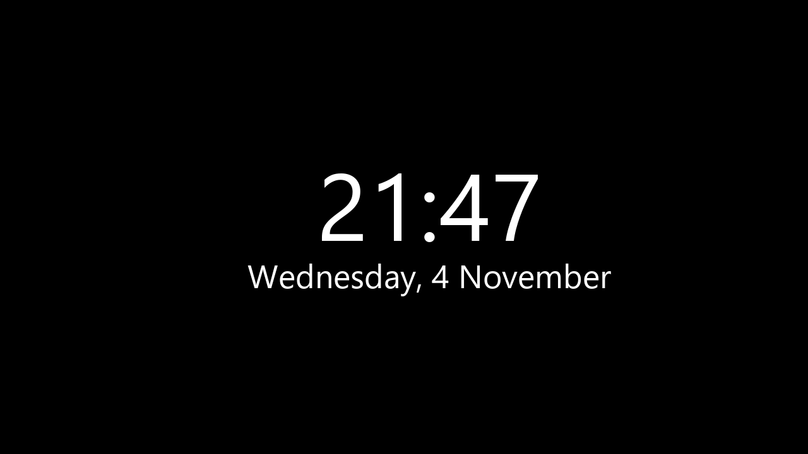

# Simple Screensaver

A minimal Android TV screensaver (`DreamService`): large text (with optional time and date) on a solid background, the weather, or the music that is playing.
Plain Java + Android framework, no AndroidX, built without Gradle. Package `dev.mibox.screensaver`, minSdk 26.



*Illustrative render using the default settings (white `{time}` / `{date}` on black); replace with a capture from your device.*

## Features
- **Text mode** (Show → Text, the default): your text with `{time}` and `{date}` placeholders (refreshed every 15 s); `\n` or Enter for new lines
- Text color, background color (presets, or any `#RRGGBB` via adb), text size
- Font: any built-in Android font family (Roboto thin/light/medium/black, condensed, serif, monospace, casual, cursive, small caps), plus bold
- Optional slow drift of the text to prevent burn-in (on by default), optional dimming
- Settings screen usable with the D-pad, plus "Save and preview"
- **Weather mode** (Show → Weather): current conditions, today's high/low and when rain starts, in one of two layouts:
  - *Your text first*: the Text mode text, with one weather line under it
  - *Full forecast board*: big temperature, next 3 days, next 6 hours with rain chance, small clock

  Location is found by city name in the settings (or set over adb), units °C/°F. Data from
  [Open-Meteo](https://open-meteo.com) (free, no API key, CC BY 4.0; credited on screen). The forecast is fetched only
  while the screensaver runs, at most every 30 min, and cached; when offline the last forecast is shown with
  "Updated N h ago", for up to 12 h. The city name shows under the conditions with a location pin.
  Needs the `INTERNET` permission. Measured on a Mi Box S: about 36 MB while running
  (Text mode: 30 MB, of which 16 MB is the screen buffer).

- **Weather photo backgrounds** (Weather background → Photos): a photo matching the current weather (clear/partly
  cloudy by day or night, cloudy, fog, rain, storm, snow), picked at random from a pool and changed every 10 min
  (5–60, a setting) and whenever the weather changes, with a cross-fade under a 40% dark layer; text turns white.
  - The pools are [res/raw/backgrounds.json](res/raw/backgrounds.json) (48 free [Unsplash](https://unsplash.com/license)
    photos; each entry links to the photo's page and photographer). The app re-reads this file from the repo's `main`
    branch once a day, so photos can be added or removed by editing it on GitHub, without reinstalling; until then,
    or offline, it uses the copy built into the app.
  - Photos are downloaded when needed (1280×720, ~150–350 KB each); the next one downloads while the current one
    shows, so a change never waits. At most 8 are kept on the box (~2–3 MB, in the app's cache folder); only the
    shown photo is in memory (two during the 1.2 s fade). Offline, it rotates through what is cached, or shows the
    solid color.

- **Now Playing mode** (Show → Now Playing): the track playing in SoundCloud, YouTube, YouTube Music or Spotify
  (other apps, such as live TV, are ignored), in one of two layouts:
  - *Ribbon* (default): the Text mode text, with cover, title, artist and progress in a slim ribbon at the bottom
  - *Album*: large cover, title, artist, album, progress and "Up next" (when the app shares its queue) on a
    background tinted from the cover; the app name and a small clock on top

  When nothing is playing it shows the Text mode text. The cover and progress bar dim after 5 min on one track.
  Needs **notification access, granted once over adb** (Android TV has no screen for it):
  ```
  adb shell cmd notification allow_listener dev.mibox.screensaver/dev.mibox.screensaver.MediaListener
  ```
  Android lets only apps with an approved notification listener read media sessions. The listener
  (`MediaListener`) reads no notifications and unbinds itself as soon as the system connects it, so it does not keep
  the app running; sessions are followed only while the screensaver runs. Covers come from the app's metadata
  (SoundCloud's are downloaded from its image server, ~30–60 KB). Measured on a Mi Box S: about 32 MB while running,
  the same as Text mode. Note: video apps (YouTube) keep the screen awake while playing, so the screensaver may only
  start with music that plays in the background.
  Undo: `adb shell cmd notification disallow_listener dev.mibox.screensaver/dev.mibox.screensaver.MediaListener`.

Design concepts for the Weather and Now Playing modes: [docs/concepts](docs/concepts/).

Defaults: `{time}\n{date}`, white on black, size 96, Roboto regular, drift on, dim off, mode Text;
weather: no location, °C, text-first layout; Now Playing: ribbon layout.

## Build
Requires the Android SDK (platforms\android-34, build-tools\34.0.0) and two JDKs: 21 and 17 (javac only).
Point the script at them with `ANDROID_HOME`, `JAVA_HOME` (JDK 21) and `JDK17_HOME`, or pass `-Sdk`, `-Jdk`, `-CompileJdk`.

```powershell
.\build.ps1
```
Output: `build\simple-screensaver.apk`, signed with the debug keystore `%USERPROFILE%\.android\debug.keystore`
(created on first run). It is a debug-signed build for personal sideloading. `build\` holds only this APK;
intermediates go to `build\obj` and are deleted after a successful build (kept on failure for debugging).

## Install and select
```powershell
adb -s <box-ip>:5555 install -r build\simple-screensaver.apk
adb -s <box-ip>:5555 shell settings put secure screensaver_components dev.mibox.screensaver/.SimpleDream
adb -s <box-ip>:5555 shell am start -a android.intent.action.MAIN -n com.android.systemui/.Somnambulator   # start it now to test
```
Or choose "Simple Screensaver" in Settings → Device Preferences → Screen saver.

## Configure
Open "Simple Screensaver" from the apps row on the TV, or over adb (run from `cmd`, or with the whole command in single quotes from PowerShell):

```
adb shell am start -n dev.mibox.screensaver/.SettingsActivity --es text "Good night\n{time}" --es fg "#FFB300" --es bg "#101830" --ei size 120 --ez drift true --ez dim false --es font sans-serif-light --ez bold false
```
`font` takes any family name from the device's `/system/etc/fonts.xml`; unknown names fall back to Roboto.

Weather:
```
adb shell am start -n dev.mibox.screensaver/.SettingsActivity --es mode weather --ef lat 32.08 --ef lon 34.78 --es place "Tel Aviv" --es units c --es wx_layout board
```
`mode` is `text`, `weather` or `music` (Now Playing, with `--es np_layout ribbon` or `album`); `units` `c` or `f`; `wx_layout` `glance` (text first) or `board`;
`--es bg_style photo` (or `solid`) and `--ei bg_minutes 10` for the photo background.
The settings activity is exported so adb can configure it; any app on the device could do the same. It only changes
display preferences.

## Undo
```powershell
adb shell settings put secure screensaver_components com.google.android.backdrop/.Backdrop
adb shell pm uninstall dev.mibox.screensaver
```
