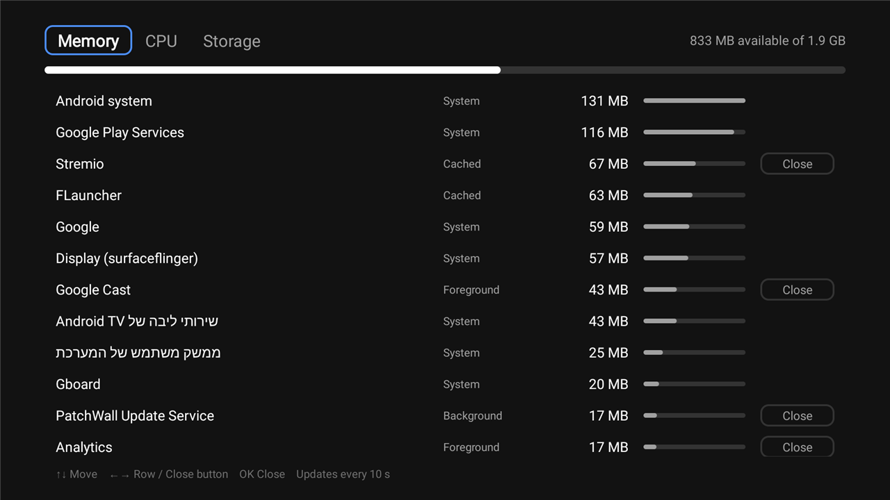
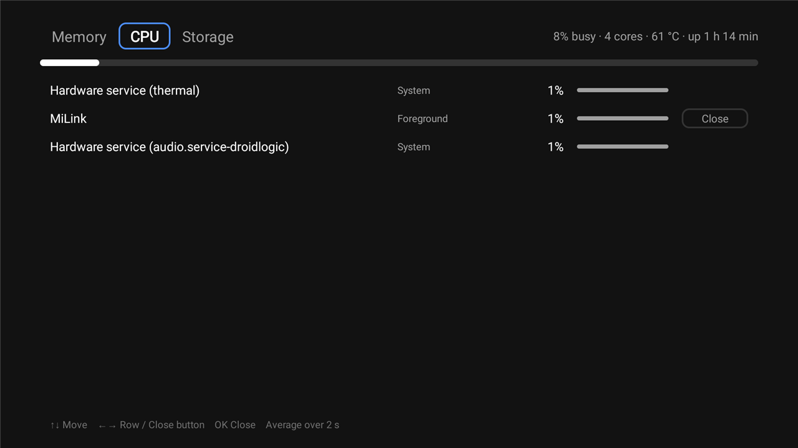
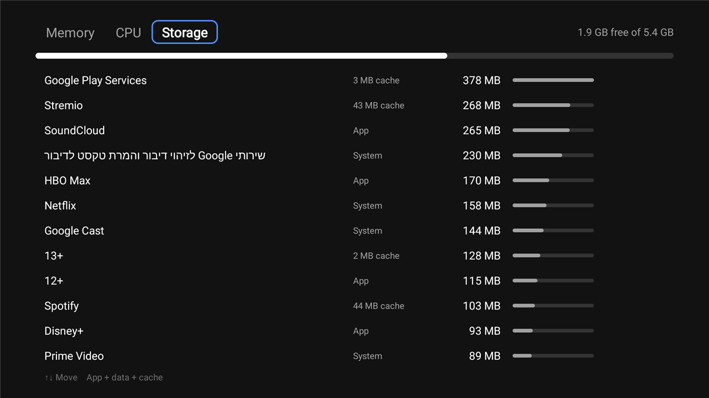

# Task Manager

A minimal Android TV task manager: Memory, CPU and Storage tabs, one row per app, and a Close
button (force-stop) on the right of every app that can be closed. Plain Java + Android framework,
no AndroidX, built without Gradle. Package `dev.mibox.taskmanager`, minSdk 26.







*Captured on a Xiaomi Mi Box 4 (Android TV 12, system language Hebrew, so some system app names are in Hebrew).*

## How it gets the data
A normal app can't see other apps' memory or CPU, or force-stop them. So the app connects to the
device's own adb service on `127.0.0.1:5555` (network debugging must be enabled) and runs these shell commands:

| Tab | Source | Refresh |
|---|---|---|
| Memory | `/proc/meminfo` (available), `dumpsys -t 30 meminfo` (PSS per app; takes ~10 s, so the default 10 s dump timeout is raised), `dumpsys activity lru` (state) | 10 s |
| CPU | `top -b -n 1 -d 2` (% of all cores), `dumpsys thermalservice` (°C; shell can't read `/sys/class/thermal`), uptime | 3 s |
| Storage | `StatFs` on `/data`, `StorageStatsManager` per app (app + data + cache) | 60 s |

Close runs `am force-stop <package>`. System apps, the home launcher, the app on screen and this
app have no Close button. Nothing runs while the screen isn't visible. A tab shows a loading indicator until its
first result arrives, then keeps showing its last result while the next one is read.

**First start:** the TV shows "Allow network debugging?" for the key `taskmanager@mibox`. Tick
"Always allow" and accept. The app also grants itself the usage-stats app op (for Storage) over
that connection. The key is stored in the app's private files; uninstalling the app removes it.

## Security notes
- Needs network debugging (adbd on TCP 5555) enabled. The app only connects to `127.0.0.1`, but adbd itself
  listens on the LAN, so keep the device on a trusted network.
- Authorizing the app gives it shell-level rights, like any adb client. It runs only the fixed read-only commands
  above, plus `am force-stop` with a validated package name and one `appops set` for itself.
- The adb private key lives in the app's private storage (`allowBackup` is off).

## Build
Same requirements as the screensaver (`ANDROID_HOME`, `JAVA_HOME` for JDK 21, `JDK17_HOME` for javac).

```powershell
.\build.ps1
```
Output: `build\task-manager.apk` (debug-signed).

## Install
```powershell
adb -s <box-ip>:5555 install -r build\task-manager.apk
adb -s <box-ip>:5555 shell am start -n dev.mibox.taskmanager/.MainActivity
```

## Undo
```powershell
adb shell pm uninstall dev.mibox.taskmanager
```
To also revoke its adb key: Settings → Device Preferences → Developer options → Revoke USB debugging authorizations
(this revokes the PC's key too; reconnect and accept again).
